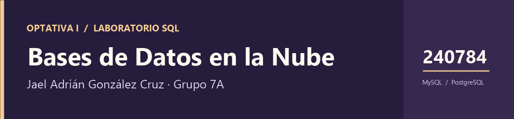

  

  <a href="https://jael240784.github.io/Practicas_BDN_240784/"><strong>Abrir el atlas MySQL</strong></a>
  · <a href="Practica04/README.md#resultados-comprobados">Ver resultados de compra</a>
  · <a href="Unidad01/README.md">Consultar infraestructura</a>

## Ruta de revisión

1. **Conecta** al entorno con las cuentas y roles de la [Práctica 02](Practica02/readme.md).
2. **Explora** las entidades y relaciones de la [Práctica 03](Practica03/README.md).
3. **Comprueba** los cinco pedidos y su trazabilidad en la [Práctica 04](Practica04/README.md).

## Prácticas y entregables

| Práctica | Trabajo realizado | Evidencia para revisar |
|:---|:---|:---|
| [**02 · Conexiones remotas**](Practica02/readme.md) | Configuración de cuentas, roles y privilegios en SQL. | [Matriz de accesos](Practica02/readme.md#usuarios-remotos-y-roles) · [Consultas SQL](Practica02/queries/consultas_verificacion.sql) |
| [**03 · Manipulación de datos**](Practica03/README.md) | Esquema MySQL para comercio, carga de perfiles y auditoría de inventario. | [Modelo EER](https://jael240784.github.io/Practicas_BDN_240784/mere.html) · [Verificación de lotes](Practica03/queries/verify_user_batches.sql) |
| [**04 · Simulación de compras**](Practica04/README.md) | Cinco escenarios con pagos, envíos, cancelaciones y devoluciones. | [Resultados por pedido](Practica04/README.md#resultados-comprobados) · [Consultas de auditoría](Practica04/queries/verify_cases.sql) |

## Explora el modelo de datos

> El atlas documenta **25 tablas, 223 columnas y 39 claves foráneas** de `db_test`. Busca una columna, abre su dominio en el modelo relacional y consulta los escenarios de compra que usan el esquema.

| [Diccionario interactivo](https://jael240784.github.io/Practicas_BDN_240784/diccionario.html) | [Modelos por dominio](https://jael240784.github.io/Practicas_BDN_240784/#modelos) | [Casos de prueba](https://jael240784.github.io/Practicas_BDN_240784/#casos) |
|:---|:---|:---|
| Tipos, nulabilidad y claves | Identidad, catálogo, compra, pagos, entrega y posventa | Pedidos y resultados documentados |

## Entorno del laboratorio

La [Unidad 1](Unidad01/README.md) reúne Docker Compose, la configuración inicial de MySQL y PostgreSQL, el informe de instalación y las evidencias de las conexiones.

---

**Ingeniería en Tecnologías de la Información e Innovación Digital**

Optativa I · Septiembre–diciembre de 2026 · Docente M.T.I. Marco A. Ramírez Hernández
